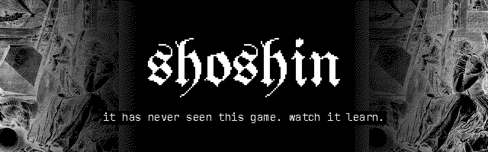
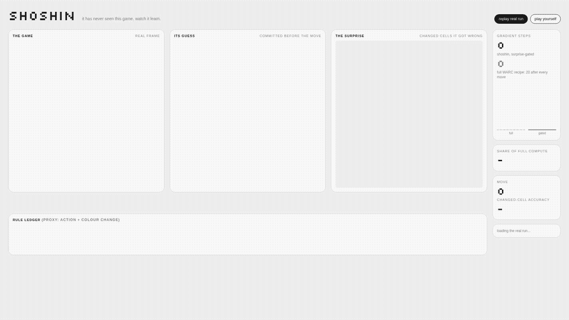
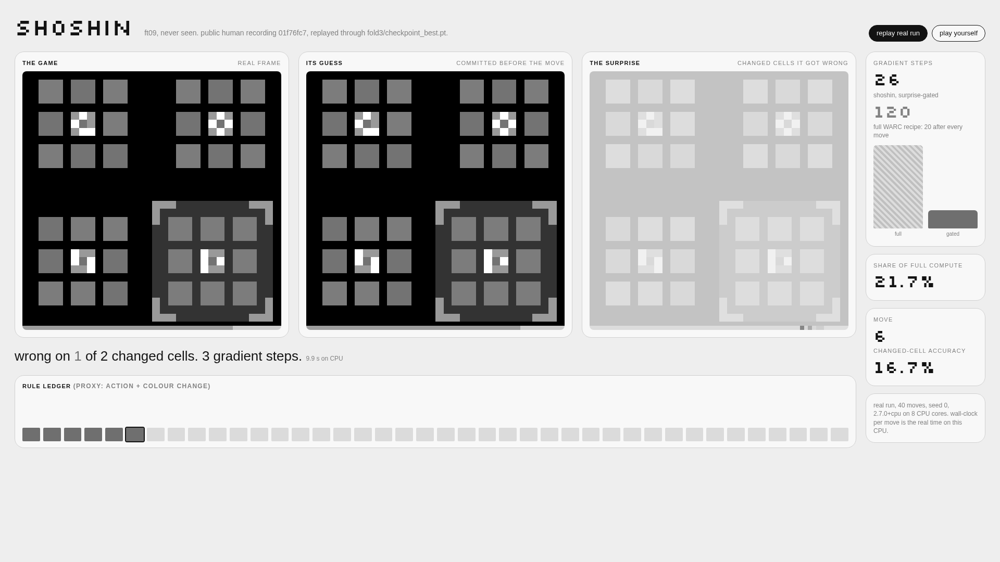
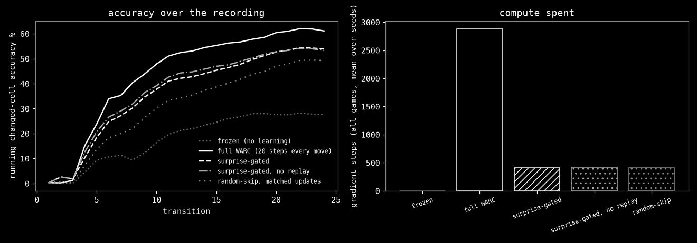
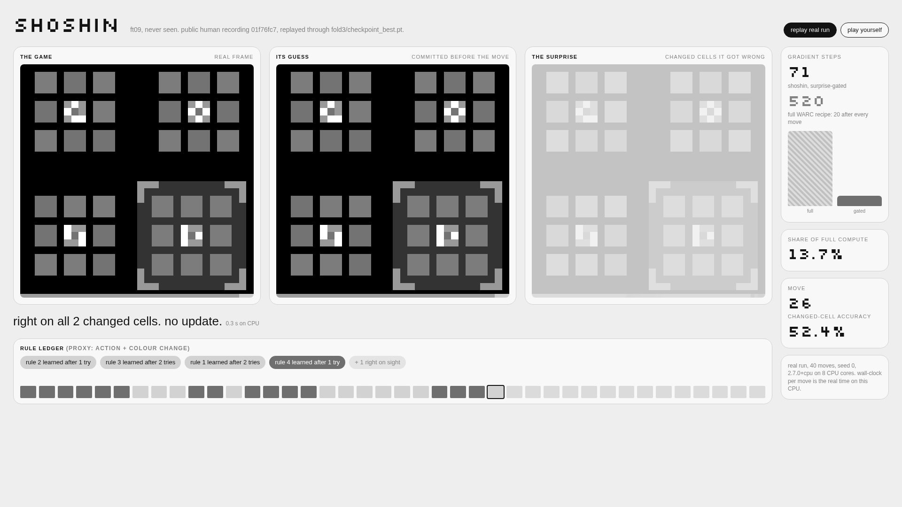
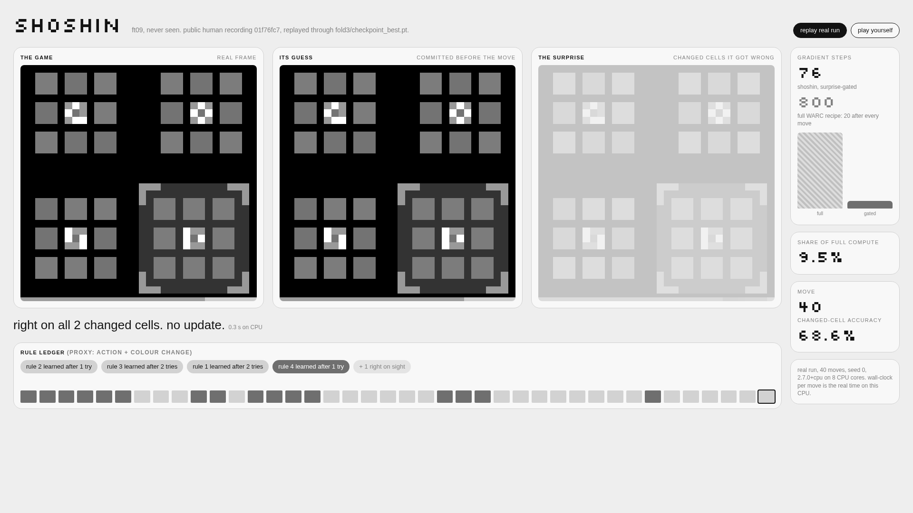
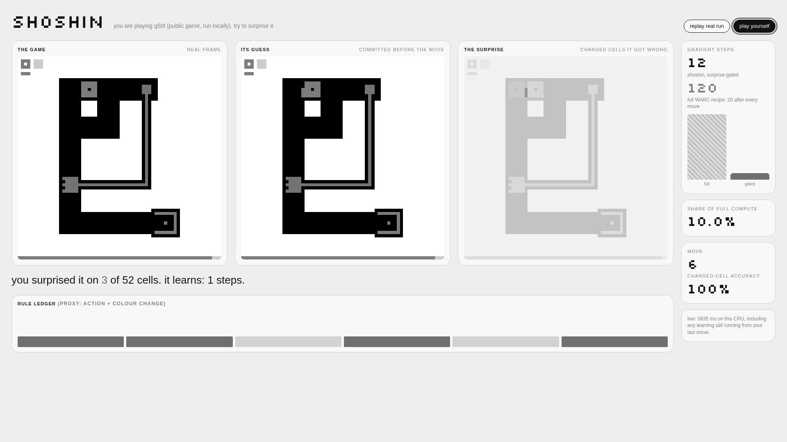

shoshin watches a 35M-parameter world model meet an ARC-AGI-3 game it has never seen, on a CPU.
Before every move the model commits its guess of the next frame. It only pays for learning when the guess was wrong.

`#ai-frontier-research` `#world-models` `#test-time-training` `#arc-agi-3` `#continual-learning` `#game-ai` `#interactive-demo` `#cpu-inference` `#pytorch`

   




## The Game

[WARC](https://github.com/third-intelligence/WARC) is a world model for ARC-AGI-3. Give it the last three frames and
an action, and it predicts the next 64x64 frame. Its authors trained three fold checkpoints, each with eight or nine
public games held out. shoshin only ever shows a game to the fold that never trained on it. WARC refuses anything else.

The moves come from the ARC Prize Foundation's public human recordings. A person played; we replay their moves and
ask the model, one move at a time, what happens next.



## The Surprise

WARC's own recipe takes 20 gradient steps after every move, including the moves it already predicts perfectly.
That is a GPU recipe. shoshin compares the committed guess with reality on the cells that changed. Right: nothing
happens. Wrong: a short update, at most 5 steps, scaled by the share of changed cells it missed, half on the new
move and half on a small buffer of earlier surprises so it does not forget.

Wrong cells glow magenta. When it gets them right again they cool to lilac.



## The Ledger

A rule here is a proxy: an action plus the colour changes it caused. When the model first predicts a rule at 80% or
better, the ledger ticks: "rule 4 learned after 3 tries". The proxy stands in for WARC's MechEval annotations, which
were not released as of 2026-11-10.

The table is regenerated from `results/runs/*.json` by `make repro`. Small-scale run: see
[docs/REPORT.md](docs/REPORT.md) for the plan, the measured cost, and what failed.

<!-- results:start -->
| arm | changed-cell accuracy % (95% CI) | gradient steps | share of full | transitions/s | EtC proxy |
| --- | --- | --- | --- | --- | --- |
| frozen (no learning) | 27.6 (23.0 to 32.3) | 0 | 0.0% | 2.39 | 1.8 (10.0% reach) |
| full WARC (20 steps every move) | 61.1 (54.1 to 67.5) | 2880 | 100.0% | 0.01 | 3.5 (48.7% reach) |
| surprise-gated | 53.9 (47.5 to 60.3) | 410 | 14.2% | 0.09 | 3.4 (44.8% reach) |
| surprise-gated, no replay | 53.3 (46.9 to 59.4) | 416 | 14.5% | 0.08 | 5.1 (37.6% reach) |
| random-skip, matched updates | 49.3 (42.7 to 56.1) | 410 | 14.2% | 0.09 | 4.8 (44.3% reach) |

| comparison | difference, points (95% CI) |
| --- | --- |
| gated minus full | -7.2 (-11.4 to -3.4) |
| gated minus random | +4.7 (+1.6 to +8.1) |
| gated minus noreplay | +0.6 (-2.1 to +3.6) |
| full minus frozen | +33.5 (+27.6 to +39.2) |

| hypothesis part | holds |
| --- | --- |
| 1 accuracy within 2 points of full (CI lower bound > -0.02) | no |
| 2 at most 25% of full gradient steps | yes |
| 3 beats matched random-skip (CI lower bound > 0) | yes |
| 4 at least 1 transition per second | no |
| holds | no |
<!-- results:end -->

The hypothesis fails. Gated learning spends 14% of the steps and beats random skipping with the same budget, but it
ends 7.2 points behind the full recipe (the bar was 2) and runs at 0.09 moves a second in the evaluation, 0.19 with the box to itself (the bar was 1).

| | |
| --- | --- |
|  |  |
|  |  |

## Install

```sh
git clone https://github.com/Sebastianrodaaa/shoshin && cd shoshin
python3 -m venv .venv && . .venv/bin/activate
make setup          # CPU torch 2.7.0, WARC (CC0) in third_party/, fold checkpoints in models/ (~0.4 GB)
make test           # dry run: the smoke test on the bundled real ft09 recording
make repro          # tables and plots from the cached logs, no model needed
make dashboard      # http://127.0.0.1:8765
```

Offline replay needs no key and no network after `make setup`. "Play yourself" runs the public game code locally
through the official `arc-agi` toolkit in offline mode; `make games` fetches it once with WARC's anonymous, read-only
download. No ARC_API_KEY is needed. If you have one (a free sign-up at ARC Prize), keep it in your environment;
shoshin never reads it from or writes it to the repository.

It touches `.venv/`, `third_party/`, `models/`, `games/` and `results/`. To undo: `rm -rf .venv third_party models
games` and `git checkout results`.

## The Name

Shoshin is the Zen idea of beginner's mind: meeting each thing openly, as a beginner would. Here it is literal.
The model has never seen the game, and the only thing it is allowed to learn from is being wrong.

## Inspirations

[WARC](https://arxiv.org/abs/2611.12324) for the model and its every-move recipe; EATA and the test-time adaptation
work that skips confident samples; surprise-driven learning in general. More in [docs/REPORT.md](docs/REPORT.md#related-work).

## License

MIT. WARC, its weights, the ARC-AGI-3 public games and recordings, the fonts and the Dürer engraving keep their own
terms: see [NOTICE.md](NOTICE.md).
