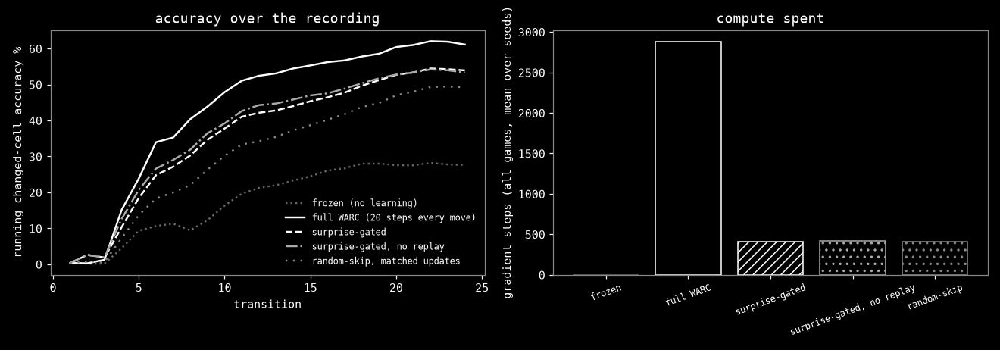

# shoshin: surprise-gated test-time learning for WARC on unseen ARC-AGI-3 games

Small-scale, CPU-only study. Every number below is regenerated from `results/` by `make repro`
(`scripts/plots.py`). Nothing here is mocked; the only mock data in the repository is the corrupted-frame test fixture
in `tests/mock_data/`, which never feeds a result.

## Question

WARC's test-time recipe takes 20 gradient steps after every transition, whether or not the model already predicted
it. On a CPU that is the whole budget. Can the model learn only when it is surprised, and keep most of the accuracy?

Hypothesis (fixed before the run, from the brief). Replaying public human recordings of each held-out game through
the WARC fold checkpoint that did not train on it, surprise-gated learning

1. keeps changed-cell accuracy within 2 points absolute of the full every-move recipe,
2. while spending at most 25% of its gradient steps,
3. beats a random-skip control that gets the same number of updates, and
4. runs at 1 or more transitions per second on this CPU.

It fails if (1) or (3) does not hold over 3 seeds (95% bootstrap CIs).

## Method

**Model.** WARC (Onoda, Kawano, Takashiro, Hayashi; arXiv:2611.12324), the released fold checkpoints, loaded on CPU
with WARC's own `FinalPredictor` (`shoshin/model.py`). Each game is only shown to the fold that held it out
(`models/manifest.json`); WARC's strict split refuses the others, and `test_shoshin.py` checks that it does.

**Data.** The ARC Prize Foundation's ARC-AGI-3 Public Demo human recordings, checked against WARC's
`data/SHA256SUMS` (340 of 340 listed files verified locally), parsed with WARC's parser into WARC's window items.
Each run replays the first T transitions of the first recording (by file name) of a game.

**Commit, compare, learn** (`shoshin/gate.py`). Before each transition the model predicts the next frame. Scored
cells are the cells that changed in reality or in the prediction. Wrong cells are scored cells where the guess
differs from reality. Changed-cell accuracy is 1 minus wrong/scored (undefined when nothing is scored). The update
budget is `ceil(5 * wrong / scored)` steps, zero when nothing is wrong; 5 is a quarter of WARC's 20, so a single
transition can never cost more than 25% of the every-move recipe. Each step trains on the new transition plus a
replay buffer of up to 64 earlier surprises, using WARC's loss, augmentation views and Muon + AdamW optimiser.

**Arms** (`shoshin/run.py`). frozen; full WARC (20 steps after every transition, WARC's replay); surprise-gated;
surprise-gated without the surprise buffer (forgetting ablation); random-skip, which gets exactly the gated run's
list of step counts (same seed), placed at uniformly random transitions.

**CPU changes, applied to every arm.** One sample per step instead of WARC's 8 (`ponytail:` note in
`shoshin/model.py`): at 8 the every-move recipe is about 216 s per transition on this box. WARC's Muon
Newton-Schulz iteration runs in fp32 instead of bf16, because this CPU has no bf16 units. The step accounting is the
same for every arm, so the comparison stays fair; absolute accuracy is not WARC's GPU number.

**Metrics.** Changed-cell accuracy per transition, averaged per run, then over games. 95% CIs are a bootstrap over
transitions and seeds (2000 resamples). Exposures to criterion (EtC) is an unsupervised proxy: a "rule" is an
action id plus the colour change it caused most often; EtC is the first exposure from which that rule stays at 80% or
better. It is a proxy, not WARC's MechEval (the annotations were not released as of 2026-11-10).

**Hardware.** One VM, 8 vCPU (Intel Xeon, no AVX-512 bf16), torch 2.7.0+cpu, no GPU.

## Results

<!-- results:start -->
<!-- results:end -->

Per game (changed-cell accuracy %, mean over seeds, and gradient steps):

<!-- pergame:start -->
<!-- pergame:end -->

**Wall-clock.** The evaluation ran three processes side by side, two threads each, so its per-transition times are
slower than one process on the whole machine. Hypothesis part 4 is judged on the dedicated smoke run (ft09, 20
transitions, seed 0, one process, 8 threads):

<!-- timing:start -->
<!-- timing:end -->

## Verdict

VERDICT

## Related work

- **WARC** (arXiv:2611.12324): the model, the checkpoints, the held-out folds and the every-move test-time recipe
  that shoshin gates. shoshin changes when and how much it learns, not what.
- **EATA** (Niu et al., ICML 2022, "Efficient Test-Time Model Adaptation without Forgetting"): skips test samples that
  are unreliable or redundant and adds an anti-forgetting term. shoshin's gate is the world-model analogue, with a
  better signal than entropy: the next frame arrives, so the error is observed, not estimated.
- **Tent** (Wang et al., ICLR 2021) and test-time training (Sun et al., ICML 2020): adapt at test time on every batch.
- **Experience replay** for continual learning (Rolnick et al., NeurIPS 2019): the surprise buffer is a tiny version.
- **Prioritised experience replay** (Schaul et al., ICLR 2016): spend updates where the error is large.
- **Surprise and curiosity** (Schmidhuber 1991; Pathak et al., ICML 2017): prediction error as the learning signal.
- **ARC-AGI-3** (ARC Prize Foundation): the public games and the Public Demo human recordings.

## Limitations

- Small scale: six held-out games (two per fold), the first 24 transitions of one recording each, 3 seeds. The
  CIs are wide and the result may not hold over whole recordings.
- One sample per step and fp32 Muon change WARC's recipe on CPU; the full arm is "WARC's schedule under the same
  CPU settings", not WARC's published GPU numbers.
- The rule proxy groups by action and dominant colour change. It over-splits some mechanics and merges others.
- Bootstrap over transitions treats transitions as independent; they are not.
- Timings are from one VM.
